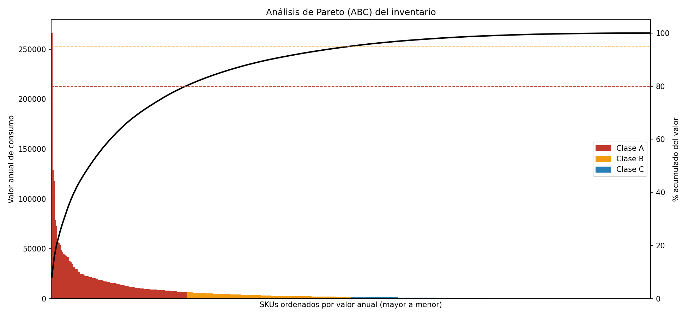

# 📦 Análisis de Pareto (ABC) para Inventarios

Proyecto en **Python** que aplica el **principio de Pareto (80/20)** a una base de datos de inventarios para clasificar los artículos (SKU) en **clases A, B y C** según su valor anual de consumo.

| Clase | Criterio (valor acumulado) | Gestión recomendada |
|-------|----------------------------|---------------------|
| **A** | Hasta 80 % del valor | Control estricto, revisión frecuente, stock de seguridad ajustado |
| **B** | 80 % – 95 % | Control moderado, revisión periódica |
| **C** | 95 % – 100 % | Control simple, pedidos en lotes grandes |



## 🧮 Metodología

1. `valor_anual = demanda_anual × costo_unitario`
2. Se ordenan los SKU de mayor a menor valor.
3. Se calcula el % de valor y el **% acumulado**.
4. Se asigna la clase según los cortes (por defecto 80 % y 95 %, configurables).

## 📁 Estructura

```
pareto-inventarios/
├── main.py                       # Punto de entrada
├── requirements.txt
├── data/inventario_ejemplo.csv   # Datos de ejemplo (500 SKUs)
├── src/pareto_inventarios/
│   ├── analisis.py               # Carga, validación y clasificación ABC
│   ├── graficos.py               # Diagrama de Pareto y distribución ABC
│   └── cli.py                    # Interfaz de línea de comandos
├── scripts/generar_datos.py      # Generador de inventario sintético
├── tests/test_analisis.py        # Pruebas unitarias
├── docs/                         # Imágenes de ejemplo
└── output/                       # Resultados generados
```

## 🚀 Instalación y uso

```bash
git clone https://github.com/<tu-usuario>/pareto-inventarios.git
cd pareto-inventarios
python -m venv venv
source venv/bin/activate        # Windows: venv\Scripts\activate
pip install -r requirements.txt

python main.py                                   # usa data/inventario_ejemplo.csv
python main.py -i mi_inventario.xlsx -o resultados
python main.py --limite-a 0.70 --limite-b 0.90   # cortes personalizados
```

### Usar tu propia base de datos

El archivo CSV o Excel debe tener estas columnas (los nombres no distinguen mayúsculas):

| Columna | Descripción |
|---------|-------------|
| `sku` | Código del artículo |
| `descripcion` | Nombre o descripción |
| `demanda_anual` | Unidades consumidas/vendidas al año |
| `costo_unitario` | Costo por unidad |

Cualquier columna adicional (categoría, stock, proveedor…) se conserva en el reporte.

### Generar datos de prueba

```bash
python scripts/generar_datos.py -n 1000 -o data/inventario_ejemplo.csv
```

## 📤 Resultados (carpeta `output/`)

- `clasificacion_abc.csv` – detalle por SKU con clase y % acumulado
- `reporte_pareto.xlsx` – hojas *Resumen* y *Detalle*
- `pareto.png` – diagrama de Pareto
- `distribucion_abc.png` – % de SKUs vs. % de valor por clase

Ejemplo de salida:

```
clase  n_skus  valor_anual pct_skus pct_valor
    A     113 2,602,272.07    22.6%     80.1%
    B     137   484,771.03    27.4%     14.9%
    C     250   162,083.21    50.0%      5.0%
```

## 🧪 Pruebas

```bash
python -m unittest discover -s tests -v
```

## 🐍 Uso como librería

```python
from pareto_inventarios import cargar_datos, clasificar_pareto, resumen_por_clase

df = cargar_datos("data/inventario_ejemplo.csv")
abc = clasificar_pareto(df, limite_a=0.80, limite_b=0.95)
print(resumen_por_clase(abc))
```

## 🗺️ Ideas para ampliar

- Análisis ABC-XYZ (variabilidad de la demanda)
- Conexión directa a SQL / ERP
- Dashboard con Streamlit
- Cálculo de EOQ y punto de reorden por clase

## 📄 Licencia

MIT – ver [LICENSE](LICENSE).
